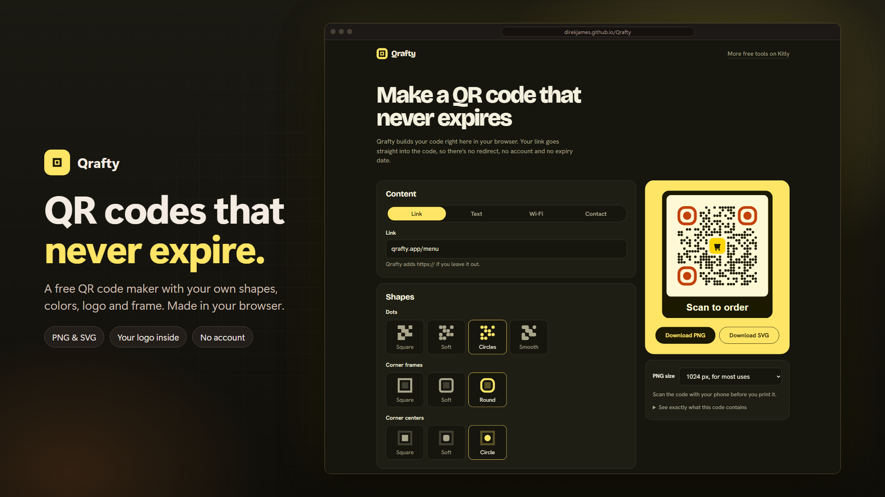
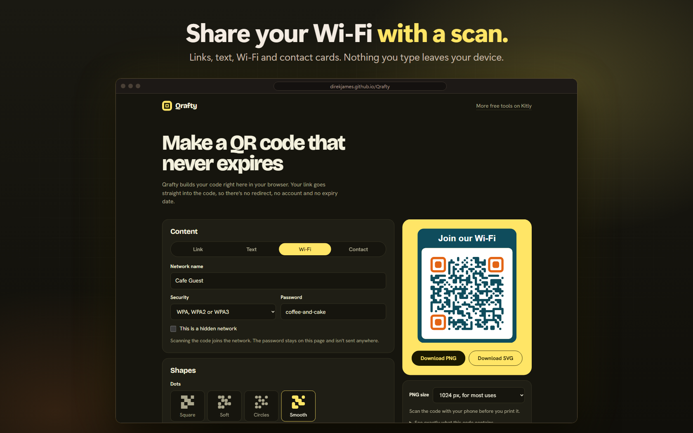

# Qrafty

**A free QR code maker with codes that never expire.**

## About

Qrafty makes QR codes right in your browser. Your link goes straight into the code, so there is no redirect, no account and no expiry date.

Nothing you type is sent anywhere. Pick the shapes and colors, add your logo and a label, then download the code.

**[Try it: direkjames.github.io/Qrafty](https://direkjames.github.io/Qrafty/)**

## Features

- Four kinds of code: **Link**, **Text**, **Wi-Fi** and **Contact card**
- Four dot shapes (Square, Soft, Circles, Smooth), plus separate shapes for the corner frames and corner centers
- Your own colors for the dots, the corner markers and the background, or a transparent background
- **Logo in the middle:** the code is made stronger automatically so it still scans
- An optional **frame** with a label above or below, such as "Scan me"
- Tips under the code when the colors are too close together or the code holds a lot
- "See exactly what this code contains" so you can check before you print
- Download as **PNG** (512, 1024 or 2048 px) or **SVG**
- Free, with no account, and the codes never stop working

## Getting started

1. Open [direkjames.github.io/Qrafty](https://direkjames.github.io/Qrafty/) in your browser.
2. Pick a type (Link, Text, Wi-Fi or Contact) and fill in the details.
3. Choose your shapes, colors, logo and frame.
4. Press **Download PNG** or **Download SVG**.
5. Scan the code with your phone before you print it.

To run it on your own computer, download this project and open `index.html`. There is nothing to install.

## Requirements

- A modern web browser (Chrome, Edge, Firefox or Safari)
- An internet connection the first time, to load the fonts

## Built with

- HTML, CSS and JavaScript, with no build step
- [QRCode for JavaScript](https://github.com/kazuhikoarase/qrcode-generator) by Kazuhiko Arase (MIT license)
- [Google Fonts](https://fonts.google.com): Bricolage Grotesque and Hanken Grotesk

## Status

Shipped.

## Credits / License

Made by [direkjames](https://github.com/direkjames). Part of [Kitly](https://direkjames.github.io/).

All rights reserved. See [LICENSE](LICENSE).
